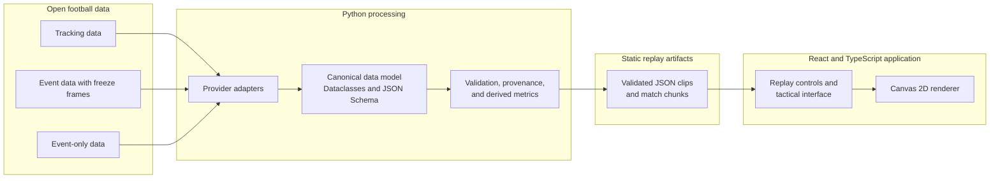

# Replay XI

> **Working title:** Replay XI may be renamed as the project develops.

Replay XI is a data-only football match reconstruction and tactical storytelling tool. It will turn open tracking and event data into interactive pitch replays that help people inspect how important moments developed.

The project is both a serious portfolio build and a learning exercise. The aim is to grow it in small, working versions while keeping every visual honest about what the source data can actually prove.

## Product progression

We will develop Replay XI in stages:

1. Replay one event.
2. Replay an important event or short passage of play.
3. Connect multiple events and meaningful sequences.
4. Attempt a full match reconstruction if the available data and performance make it credible.

The exact versions between these stages will be decided through experimentation.

## Data fidelity

Replay XI will adapt its presentation to the quality of the available dataset.

| Data mode | What Replay XI can show |
| --- | --- |
| Continuous tracking data | Player and ball movement over time, subject to the dataset's sampling rate and quality. |
| Event data with freeze frames | Accurate event moments and player positions captured at those moments. Any movement between snapshots must be clearly identified as interpolation. |
| Event-only data | Discrete actions, locations, timing, and relationships between events. It must not imply that unknown continuous movement was observed. |

Data provenance, confidence, gaps, and transformations should remain visible rather than being hidden behind a convincing animation.

## Stack so far

| Area | Choice | Role |
| --- | --- | --- |
| Data processing | Python | Ingest provider data, normalise it, validate it, and calculate derived information. |
| Canonical data contract | Python dataclasses and JSON Schema | Define the shared match, player, frame, and event structures used across the project. |
| Web interface | React and TypeScript | Build the replay controls, tactical views, and supporting interface. |
| Frontend tooling | Vite | Run and build the web application with a small amount of setup. |
| Pitch rendering | Canvas 2D | Draw and animate the pitch, players, ball, trails, and overlays efficiently. |
| Styling | Plain CSS or CSS Modules | Keep styling understandable while the interface is still evolving. |
| Python tests | pytest | Test adapters, transformations, validation, and derived metrics. |
| Web tests | Vitest | Test TypeScript logic and React components. |
| Browser tests | Playwright, later | Test complete user journeys once the interface is stable enough. |
| Initial data format | JSON | Keep early datasets and replay clips easy to inspect and debug. |
| Larger data, if needed | Parquet and DuckDB | Support larger match collections only when JSON becomes a real limitation. |
| Initial deployment | Static hosting | Publish the processed replay data and browser application without a permanent backend. |

A backend is not part of the initial architecture. If features such as accounts, saved stories, collaborative annotations, or private datasets eventually justify one, the current preference is FastAPI with PostgreSQL.

## Architecture

Provider-specific differences stop at the Python adapters. Everything after that boundary should use the same canonical data contract, allowing the frontend to render the best honest representation available without being tied to one data provider.

## Constraints and non-goals

- No match footage, computer vision pipeline, or GPU dependency.
- No paid API or required paid cloud service for the initial build and deployment.
- No invented continuous movement when the source contains only discrete events.
- No database, authentication system, or permanent API until a real product need justifies them.
- No premature rendering complexity such as WebGL while Canvas 2D remains sufficient.

Candidate datasets for early experiments include openly available samples from Metrica Sports, SkillCorner, and StatsBomb. Any data included or used by the project must follow its source licence and attribution requirements.

## Current status

Replay XI is at the architecture and project-planning stage. No application has been scaffolded yet. The first implementation milestone will be chosen after the initial workflow and rules of engagement are agreed.
